# LoomGuard: Architecture

Open this file in VS Code and press `Ctrl+Shift+V` to see the diagrams. They are Mermaid diagrams; the `bierner.markdown-mermaid` extension renders them in the preview and GitHub renders them natively.

Related documents: [DATASETS.md](DATASETS.md), [EVALUATION.md](EVALUATION.md), [IMPLEMENTATION_PLAN.md](IMPLEMENTATION_PLAN.md).

Colour legend used in every diagram:

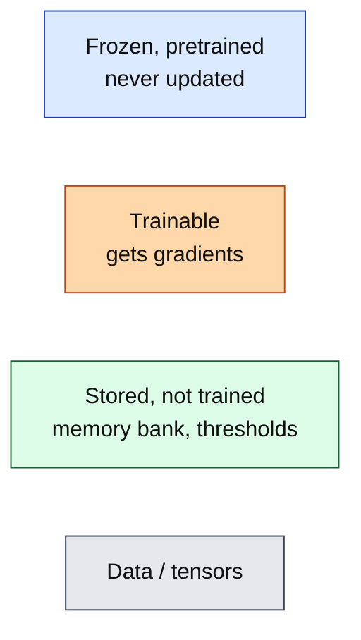

## 1. What the system is

LoomGuard learns what normal fabric looks like from defect-free images only. For a new image it gives:

1. an anomaly score per 256x256 tile (is this tile defective),
2. a per-pixel heatmap and a binary defect mask (where),
3. a defect list with sizes, penalty points and a quality grade (how bad).

Steps 1 and 2 are the model. Step 3 is plain image processing on top of the mask. There are no defect-type labels and no box detector.

Two models solve steps 1 and 2 independently and are compared on the same data:

| | PatchCore | Reverse Distillation (RD4AD) |
|---|---|---|
| Idea | Remember normal patches, measure distance to the nearest one | Train a decoder to rebuild teacher features of normal fabric; it fails on defects |
| Where "normal" lives | A stored memory bank | Trained weights |
| Gradient training | None | Yes (bottleneck and decoder) |
| Backbone | WideResNet-50-2, frozen, ImageNet weights | Same |
| Layers used | layer2, layer3 | layer1, layer2, layer3 |

## 2. System overview

Training and evaluation run on the training PC. The laptop is for code, documentation, tests on tiny data, and the CPU demo.

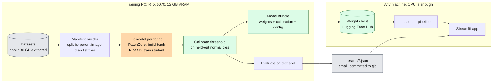

Key rule: **one model bundle per fabric profile.** A fabric profile is one fabric the system has learned (a RAW-FABRID roll, a ZJU-Leaper pattern, an AITEX fabric). The unified and per-group regimes in the cross-fabric study are bundles that happen to cover several fabrics.

## 3. Inference data flow

Example with one RAW-FABRID image (1792x1024, grayscale, 448 mm x 256 mm of fabric).

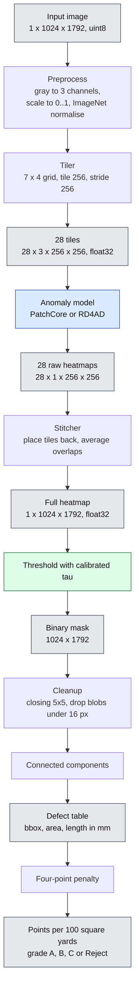

### Tiler and stitcher

Every model sees 256x256 tiles at the dataset's native resolution. Images are not shrunk, because thin defects such as a broken yarn can be 1 to 3 pixels wide and vanish when downscaled.

For each image side of length `L` with tile size `T = 256`:

- number of tiles `n = ceil(L / T)`
- tile origins are spread evenly so the last tile ends exactly at the edge: `x_i = round(i * (L - T) / (n - 1))`
- if `L < T` the image is reflect-padded to `T`
- where tiles overlap, the stitcher averages the heatmaps

| Dataset | Image size | Tiles per image | Overlap |
|---|---|---|---|
| RAW-FABRID | 1792 x 1024 | 7 x 4 = 28 | none |
| ZJU-Leaper | 512 x 512 | 2 x 2 = 4 | none |
| AITEX | 4096 x 256 | 16 x 1 = 16 | none |
| TSFabrics (optional) | 800 x 640 | 4 x 3 = 12 | 75 px horizontal, 64 px vertical |
| MVTec AD textures | 1024 x 1024 | 1 (whole image resized to 256) | exception, see below |

MVTec AD is the one exception: images are resized to 256x256 as a whole, because that is the protocol behind the published numbers we must reproduce.

Calibration knob: `min_overlap` (default 0). Convolution padding makes features near tile borders slightly less reliable. If seams show up as false alarms, set an overlap of 32 px; the stitcher already averages.

Code: `loomguard/data/tiling.py` (`tile_origins`, `grid`, `tile`, `stitch`). Stitching accumulates in float64, so tile then stitch returns the input bit for bit. Preprocessing (`preprocess`: gray to 3 channels, scale, ImageNet normalise) lives in `loomguard/data/dataset.py`. Manifest rows carry the crop box, fabric, split, parent, mask path, label and defect pixel count (`loomguard/data/manifest.py`).

Training-time sampling differs from inference: Reverse Distillation trains on random 256x256 crops of the parent images (free translation augmentation). PatchCore and all evaluation use the fixed grid.

No flips or rotations by default. Weave direction is part of what makes a fabric normal, and a mirrored twill is a real defect.

## 4. Shared backbone

`torchvision.models.wide_resnet50_2` with `IMAGENET1K_V1` weights, in `eval()` mode, `requires_grad=False`. `layer4`, the average pool and the classifier are never run.

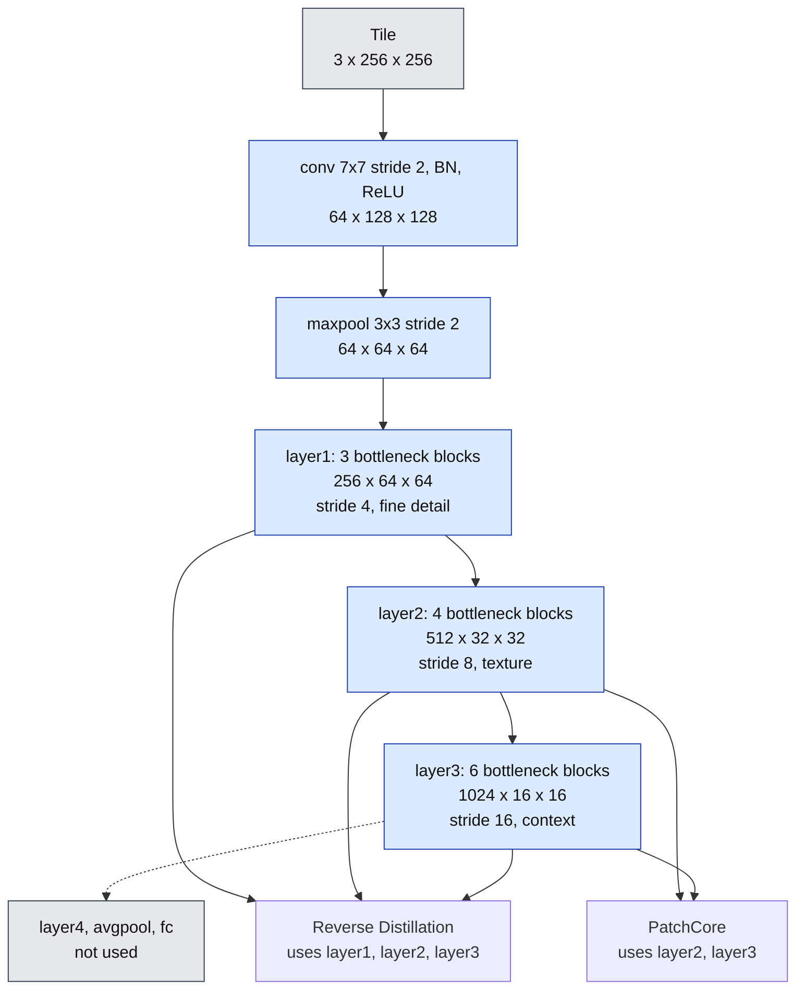

| Stage | Output shape (C x H x W) | Stride | Parameters |
|---|---|---|---|
| stem + maxpool | 64 x 64 x 64 | 4 | 0.01 M |
| layer1 | 256 x 64 x 64 | 4 | 0.63 M |
| layer2 | 512 x 32 x 32 | 8 | 3.48 M |
| layer3 | 1024 x 16 x 16 | 16 | 20.74 M |
| **Used part, total** | | | **24.86 M, all frozen** |

Why intermediate layers: the last layers of an ImageNet classifier encode object classes, which are useless for fabric. Layers 1 to 3 encode edges, weave texture and local structure.

## 5. Method 1: PatchCore

No gradients. "Training" is one pass over normal tiles to fill a memory bank.

### 5.1 Building the memory bank

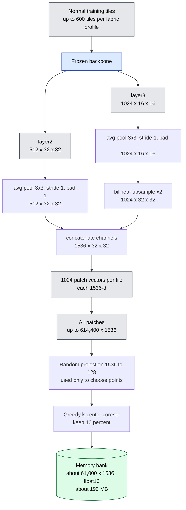

- **Local averaging (3x3 pool):** each patch vector describes a small neighbourhood, which makes it robust to one-pixel shifts.
- **Tile cap (600):** 600 tiles x 1,024 patches x 1,536 floats is 3.8 GB in float32, which fits in RAM. Larger fabric profiles are subsampled at random, stratified by parent image. This removes the "memory bank grows with data" problem from the starter file.
- **Coreset:** greedy k-center picks patches that cover the feature space evenly, so rare-but-normal texture is kept. Selection runs on the GPU on the 128-d projection; the stored vectors are the original 1,536-d ones.
- **Coreset ratio:** 10 percent for benchmarks. 1 percent (about 6,000 vectors, 19 MB) for the CPU demo. The PatchCore paper reports almost no loss at 1 percent on textures.

Code: `loomguard/models/backbone.py` (`Backbone`, `gaussian_blur`), `loomguard/models/patchcore.py` (`PatchCore.embed/fit/score/save/load`, `greedy_coreset`). The bank is saved as a plain float16 tensor. All patch vectors are held as float16 on the CPU, only the 128-d projection goes to the GPU for the coreset.

### 5.2 Scoring a tile

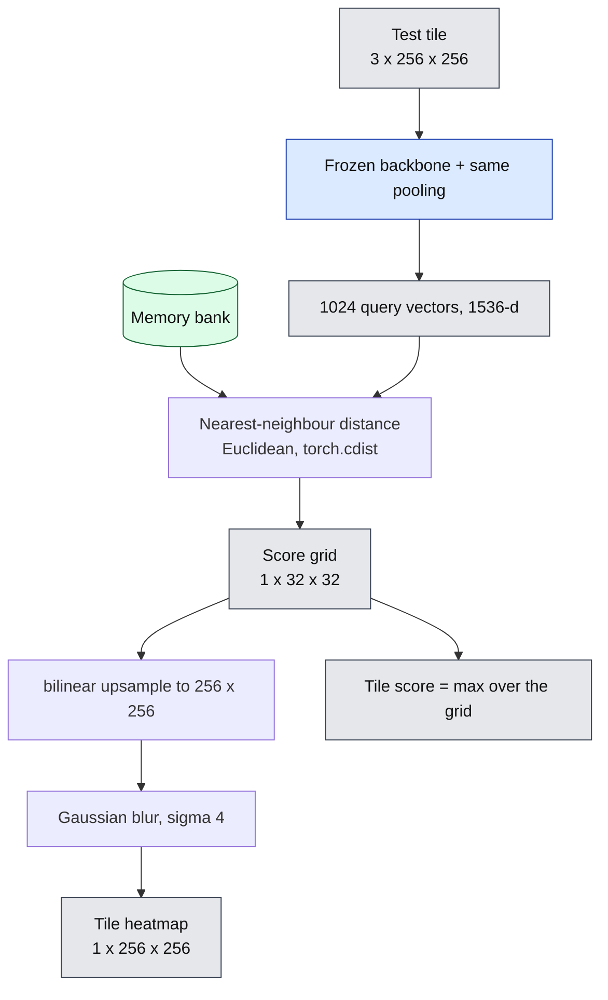

Simplifications against the paper, each with its upgrade path:

| Simplification | Paper version | When to upgrade |
|---|---|---|
| Concatenate to 1,536-d | Adaptive pooling to 1,024-d | Only if the MVTec sanity check misses its target |
| Tile score = max patch distance | Max distance re-weighted by neighbour density | Same |

**Two tile scores, two jobs (decision A-15).** `PatchCore.score` returns the max of the unblurred grid as its tile score; this is the published quantity and feeds the threshold-free `tile_auroc` and `tile_ap`. The operating decision (calibration, "is this tile flagged", the mask) uses one map for everything: the maximum of the blurred tile heatmap, for both methods. A tile is flagged exactly when at least one of its heatmap pixels is above `tau`. For RD4AD the two scores are the same number.
| Exact search with `torch.cdist` | FAISS index | If CPU latency per tile exceeds the demo budget |

## 6. Method 2: Reverse Distillation (RD4AD)

The teacher is the frozen backbone. The student is a bottleneck plus a decoder that mirrors the teacher backwards. The student only ever sees normal fabric, and it must rebuild the teacher's feature maps from a compressed embedding. On a defect, the teacher's features change but the student rebuilds what normal fabric would look like, so the two disagree.

### 6.1 Network

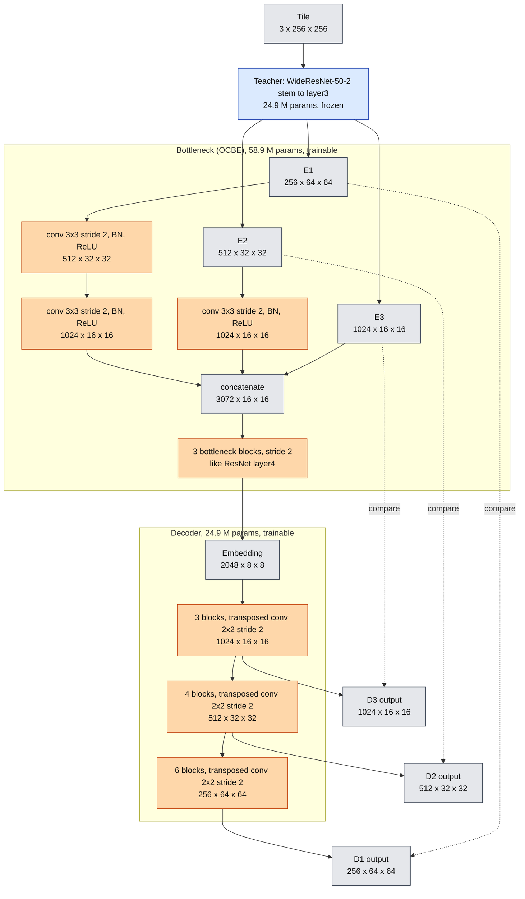

| Part | Parameters | Trained | Notes |
|---|---|---|---|
| Teacher (stem to layer3) | 24.86 M | No | ImageNet weights, `eval()` mode always, so BatchNorm statistics stay fixed |
| Bottleneck: fusion convs | 10.62 M | Yes | Bring E1 and E2 down to 16 x 16 and 1,024 channels |
| Bottleneck: embedding blocks | 48.26 M | Yes | 3,072 to 2,048 channels, 16 x 16 to 8 x 8 |
| Decoder | 24.92 M | Yes | Reverse of layers 3, 2, 1 with transposed convolutions |
| **Student total** | **83.80 M** | **Yes** | Checkpoint is 335 MB in float32, 168 MB in float16 |

Only the student is saved. The teacher is rebuilt from torchvision weights at load time.

The squeeze from three maps (about 1.8 M numbers) into 2,048 x 8 x 8 (131 k numbers) is the mechanism: fine anomalous detail does not survive it, so the decoder cannot copy a defect back out.

### 6.2 Training

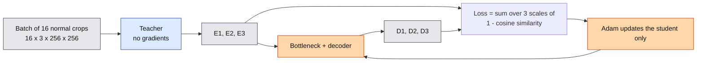

Loss for one image, following the official implementation: at each scale `k`, flatten the teacher map `E_k` and the student map `D_k` to one vector each and take `1 - cos(E_k, D_k)`. Sum the three scales, average over the batch.

| Setting | Value | Source |
|---|---|---|
| Optimiser | Adam, learning rate 0.005, betas (0.5, 0.999) | Paper |
| Batch size | 16 | Paper |
| Input | 256 x 256 | Paper |
| Length | **5,000 iterations** per fabric profile, 10,000 per group, 20,000 unified | Ours. The paper's 200 epochs on MVTec is about 3,500 iterations. |
| Mixed precision | `torch.autocast` with bfloat16 on CUDA only (no loss scaler; the loss itself is float32); off on CPU | Ours, for 12 GB VRAM headroom (decision A-10) |
| Crops | Random 256 x 256 window of a random train parent image, no flips or rotations (MVTec: the whole resized image) | D-22, decision A-11 |
| Checkpoint choice | Last checkpoint | Ours, see below |
| Seed | Fixed, recorded in the config | Ours |

**No test-set peeking.** The official RD4AD code evaluates on the test set during training and reports the best epoch. That leaks test data into model selection. LoomGuard trains for a fixed budget and takes the last checkpoint. Validation loss on held-out normal tiles is logged only to spot divergence.

Expected VRAM at batch 16 is well under 12 GB. Phase 3 measures and records the real peak.

### 6.3 Scoring a tile

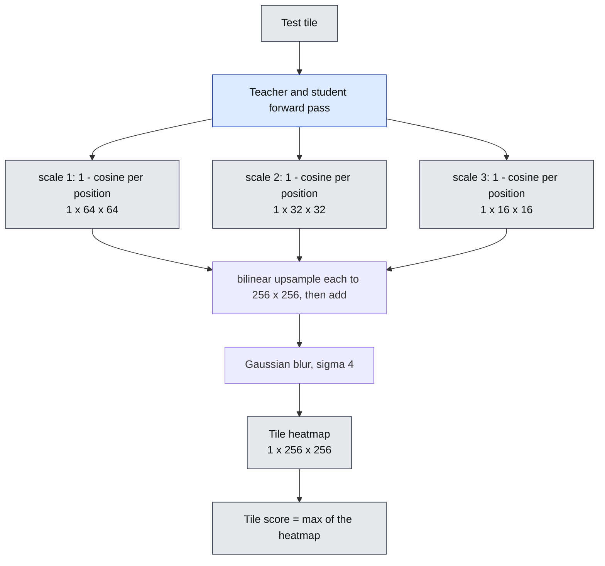

Here the cosine is taken per spatial position across channels, which gives a map. The training loss uses the flattened version, which gives one number.

## 7. Optional method 3: Dinomaly (stretch)

Recommended over EfficientAD as the third method. Decision is made at the Phase 7 gate, not now.

| | Dinomaly | EfficientAD |
|---|---|---|
| What it adds | A different feature family (self-supervised vision transformer) and a model designed for one unified model over many classes, which is exactly our cross-fabric question | Low latency |
| Extra requirements | DINOv2 weights (download) | An ImageNet image stream during training and a pre-distilled teacher; no official code |
| Is its strength needed | Yes: the unified regime is where Reverse Distillation is expected to struggle | No: latency is not our bottleneck |
| Licence of reference code | Apache-2.0 | none official |

Sketch, to be detailed only if the gate passes:

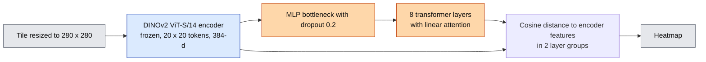

ViT-Small (37 M parameters) is the 12 GB-safe choice. The paper reports 99.3 image AUROC on multi-class MVTec AD for ViT-Small against 99.6 for ViT-Base.

## 8. Calibration

Each bundle carries one threshold `tau`, set without any defect data:

1. Run the model on the held-out normal validation tiles of that fabric profile.
2. Take each tile's heatmap maximum (the blurred heatmap, for PatchCore as well as RD4AD, decision A-15).
3. `tau` is the `ceil((n + 1) * 0.99) / n` quantile of those maxima, so about 1 percent of normal tiles exceed it.

The same `tau` gives the tile decision (score above `tau`) and the pixel mask (heatmap above `tau`). One threshold, one source of truth. The target false-alarm rate (default 1 percent) is a config value.

The bundle also stores the median and 99th percentile of validation scores, so the UI can show scores on a common 0 to 1 style scale across models. Fewer than 500 validation tiles sets `low_confidence` in `calibration.json`. Code: `loomguard/eval/calibrate.py` (`calibrate`, `val_peaks`); `scripts/fit.py` writes the file.

## 9. Inspection and grading

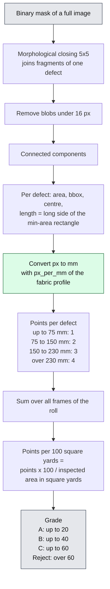

- The point bands are the textile four-point system (3, 6 and 9 inch limits). The value 40 points per 100 square yards is the commonly used acceptance limit. **The A, B, C and Reject cut-offs are project assumptions** (accepted by the team on 2026-11-12) and live in the config.
- The four-point system scores holes differently. LoomGuard cannot tell a hole from another defect without defect-type labels, so holes are scored by length like everything else. This is stated in the UI.
- `px_per_mm`: 4.0 for RAW-FABRID (stated by the dataset), 5.0 for TSFabrics (derived from 127 PPI). For ZJU-Leaper, AITEX and uploaded images of unknown origin the value is an assumption and the UI labels the result "assumed scale".
- **A grade is only meaningful for a roll.** One RAW-FABRID frame is 0.137 square yards, so a single 1-point defect extrapolates to 730 points per 100 square yards. For a single uploaded image the app shows defects and points, and marks the grade as an extrapolation. Roll mode sums over all frames.
- Minimum blob area, closing size and the grade cut-offs are calibration knobs in the config (`grading: {closing, min_area_px, cutoffs}`; `px_per_mm`, `scale_assumed`). Code: `loomguard/inspection/postprocess.py` (closing by max-pool, components from `eval/metrics.py`, minimum-area rectangle by a 1 degree rotation search), `loomguard/inspection/grading.py`. Points bands are inclusive upper limits (a 75 mm defect scores 1).

## 10. Model bundle

Everything the Inspector needs for one fabric profile and method:

```
artifacts/<dataset>/<fabric>/<method>/
  model.pt            PatchCore: memory bank tensor (float16)
                      RD4AD: student state dict (float16)
  calibration.json    tau, target false-alarm rate, n_val_tiles, low_confidence, median / p99 / min / max of the validation heatmap maxima
  config.yaml         tile size, layers, coreset ratio or training settings, px_per_mm, seed
  metrics.json        fit-side system metrics, then the test metrics of this bundle
                      (RD4AD: iterations, iters_per_second, final_train_loss, final_val_loss, loss_curve, peak_vram_gb)
```

- `artifacts/` and `data/` are git-ignored. GitHub rejects files over 100 MB and an RD4AD student is 168 MB.
- Bundles are shared through a Hugging Face Hub model repository. The app downloads the ones it needs on first use.
- Bundles are loaded with `torch.load(..., weights_only=True)`, which refuses pickled code.
- `results/` holds small JSON and CSV metric files and is committed, so results are visible without a GPU.

## 11. Streamlit application

Streamlit is a course requirement. The app runs on CPU and is deployed on the free CPU tier of Hugging Face Spaces (limits to be confirmed at deploy time). Three pages:

```
+----------------------------------------------------------------------------------+
| LoomGuard                                   [Inspect image] [Roll stream] [Results]
+----------------------+-----------------------------------------------------------+
| Fabric profile  [v]  |  Original            | Heatmap overlay      | Defect mask   |
| Model           [v]  |  +---------------+   | +---------------+    | +-----------+ |
|  PatchCore / RD4AD   |  |               |   | |     ..##..    |    | |    ##     | |
| Sensitivity  [--o--] |  +---------------+   | +---------------+    | +-----------+ |
| Scale: 4.0 px/mm     |                                                           |
| [ Upload image ]     |  Verdict: DEFECTIVE   score 0.83   threshold 0.41          |
| or pick a sample     |  # | length mm | area mm2 | position      | points          |
|                      |  1 |   61.2    |   48.0   | x 310, y 122  |   1             |
|                      |  2 |  104.5    |   95.3   | x 990, y 640  |   2             |
+----------------------+-----------------------------------------------------------+
```

| Page | What it does |
|---|---|
| Inspect image | Upload one image or pick a bundled sample. Shows heatmap overlay, mask, defect table, points. |
| Roll stream | Plays the frames of a demo roll in order, as on a moving line. Live defect log, running points per 100 square yards, final grade. |
| Results | Benchmark tables and plots read from `results/`. PatchCore against RD4AD per fabric and regime. |

Design points:

- The user must choose a fabric profile. A one-class model only knows the fabric it was fitted on; an image of any other fabric lights up everywhere. The app says so when nearly the whole image is flagged.
- Upload is a trust boundary: accept PNG, JPEG, TIFF and BMP only, cap the file size and pixel count, decode with Pillow inside a `try`, and never use the uploaded filename as a path.
- Models are cached with `st.cache_resource`. The sensitivity slider moves `tau` without re-running the model.
- CPU budget: a 1792x1024 image is 28 tiles. Target under 10 s with PatchCore at 1 percent coreset. Measured in Phase 6.
- A few RAW-FABRID sample images (CC BY 4.0, with attribution) ship in `assets/samples/` so the demo works with no dataset. MVTec images are never shipped.

## 12. Repository layout (planned)

```
loomguard/
  data/        tiling.py, manifest.py (one adapter per dataset), dataset.py
  models/      backbone.py, patchcore.py, rd4ad.py
  eval/        metrics.py, calibrate.py
  inspection/  postprocess.py, grading.py
  runs.py      config, manifest dispatch, fabric profiles, tile cap, paths and model loading shared by fit.py and evaluate.py
               (a config's `tag` is appended to the method directory, e.g. rd4ad_s1, so seeds do not overwrite each other)
  pipeline.py  Inspector: bundle + image in, heatmap + defects + grade out
               (the package is "inspection", not "inspect", which would shadow the standard library)
scripts/       verify_datasets.py, fit.py, evaluate.py
app/           streamlit_app.py
configs/       one YAML per dataset and method
tests/         CPU-only, synthetic textures, no dataset needed
results/       committed metric files
docs/
```

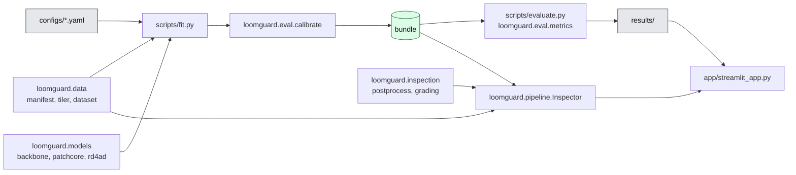

The Inspector is the single code path for evaluation and for the app. The app never has its own copy of tiling, scoring or grading.

## 13. Team workflow

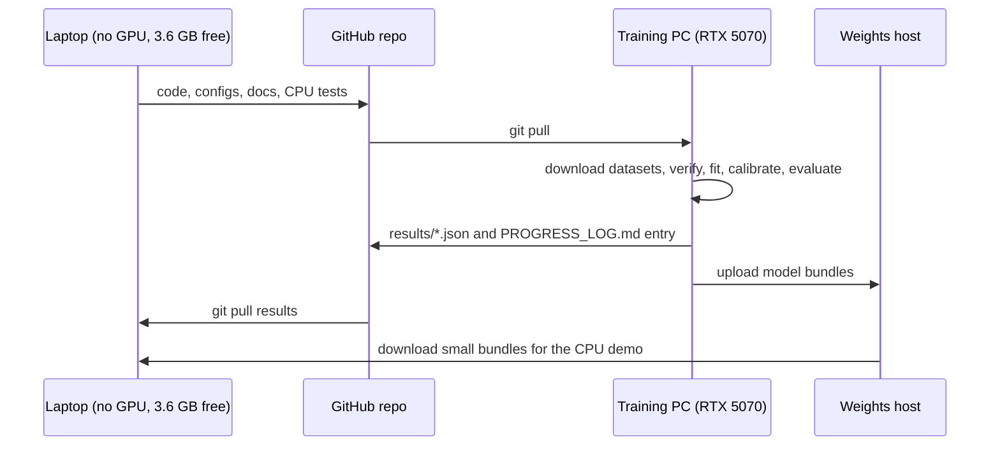

Environment:

| Machine | Python | PyTorch |
|---|---|---|
| Training PC | 3.11 or newer | **2.7 or newer with CUDA 12.8 wheels.** The RTX 50 series is not supported by older builds. Check that `torch.cuda.get_arch_list()` contains `sm_120`. |
| Laptop | same | CPU wheel (about 200 MB download). Tests use synthetic textures and tiny tensors. |

## 14. Design decisions and their reasons

| Decision | Reason |
|---|---|
| Tiles at native resolution, never shrink | Thin defects disappear when downscaled. The Lusitano paper's 0.886 AUC at 256x256 on shrunken images shows the cost. |
| Manifest of crop boxes, no tiles written to disk | Saves disk and keeps one loading path for every dataset |
| PatchCore tile cap and float16 bank | Bounds memory and search time regardless of dataset size |
| Fixed iteration budget, last checkpoint | No defect data may influence training or model selection |
| One threshold per bundle from normal validation tiles | The realistic setting: a factory has no labelled defects when a new fabric starts |
| Inspector shared by evaluation and app | The numbers in the report are produced by the code the demo runs |
| Own implementations, no anomaly-detection library | The project goal is to learn by implementing the papers. The MVTec sanity check replaces trust in a library. |
| No experiment tracker | JSON files in `results/` are enough for two methods and four datasets |
