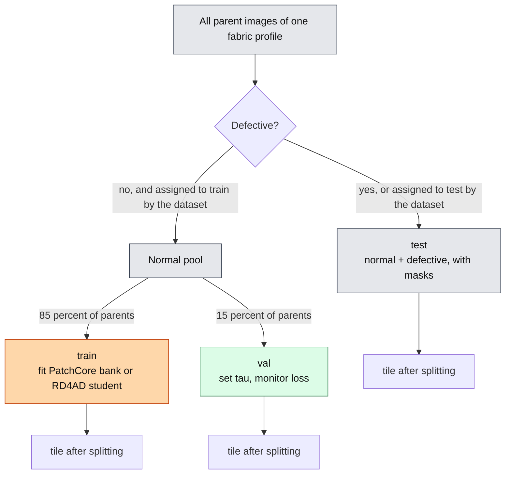

# LoomGuard: Evaluation, Metrics and Splits

Related documents: [DATASETS.md](DATASETS.md), [ARCHITECTURE.md](ARCHITECTURE.md).

## 1. Questions the evaluation must answer

| # | Question | Where it is answered |
|---|---|---|
| Q1 | Are our PatchCore and Reverse Distillation implementations correct? | MVTec AD textures against published numbers |
| Q2 | Which method is better on real fabric with one model per fabric? | RAW-FABRID per roll, ZJU-Leaper per pattern, AITEX per fabric |
| Q3 | What happens when one model must cover many fabrics? | ZJU-Leaper per group and unified; RAW-FABRID unified |
| Q4 | What happens on a fabric the model never saw? | Held-out pattern (ZJU-Leaper), leave-one-roll-out (RAW-FABRID) |
| Q5 | Does a threshold set on normal data alone hold its false-alarm rate? | Calibration check on test-normal tiles |
| Q6 | Is the quality grade from predicted masks close to the grade from true masks? | RAW-FABRID rolls |
| Q7 | Which settings matter? | Ablations: resolution policy, coreset ratio, training-set size |

If PatchCore wins everywhere, that is a valid result. The deliverable is the comparison, not a winner.

## 2. Metrics

### 2.1 Threshold-free metrics (compare models)

| Metric | Level | Role | Why |
|---|---|---|---|
| **AUROC** | tile or image | **Primary detection metric** | Ranks defective above normal, independent of any threshold |
| Average precision (AP) | tile or image | Secondary | More honest than AUROC when defective samples are rare |
| **AUPRO at FPR up to 0.3** | pixel | **Primary localization metric** | Every defect region counts equally, so small defects are not drowned out by large ones |
| Pixel AUROC | pixel | Secondary, for comparison with papers | Dominated by the huge number of normal pixels; can look good while small defects are missed |
| Pixel AP | pixel | Secondary | Sensitive to how well defect pixels are separated under heavy imbalance |

AUPRO: for each threshold, compute for every ground-truth connected component the fraction of its pixels that are flagged, and average over components. Plot that against the pixel false-positive rate on normal pixels. Integrate from 0 to 0.3 and divide by 0.3.

Implementation rules:

- Detection and pixel AUROC/AP come from `sklearn.metrics`. AUPRO is our own code, tested against a brute-force version on toy masks.
- Pixel metrics on large test sets (RAW-FABRID has about 370 million test pixels) are computed from score histograms with 10,000 bins, not from sorted raw scores.
- A tile is labelled defective if its ground-truth mask has at least one defect pixel. This matches the RAW-FABRID official patches.

### 2.2 Operating-point metrics (what a factory would see)

All use the single threshold `tau` calibrated on normal validation tiles (see ARCHITECTURE.md, section 8). No defect data touches `tau`.

| Metric | Definition |
|---|---|
| False alarms per 1,000 normal tiles | Normal test tiles with score above `tau`, per 1,000. Target is 10. |
| Tile recall | Fraction of defective test tiles with score above `tau` |
| Pixel Dice and IoU | Overlap of the cleaned predicted mask with the ground truth, over all defective test tiles |
| ZJU-Leaper official metrics | F1 pixel (Dice), F1 region, F1 sample from the official `ZLEval`, for comparison with the dataset paper |

### 2.3 Grading metrics (RAW-FABRID rolls)

The same grading code runs twice per roll: once on predicted masks, once on ground-truth masks.

| Metric | Definition |
|---|---|
| Points error | Absolute difference in points per 100 square yards between the two |
| Grade agreement | Fraction of rolls where both give the same grade |
| Defect count error | Difference in number of defects found |

### 2.4 System metrics

Latency per tile on the GPU and on a CPU, peak VRAM during fitting, fitting time, bundle size on disk. Recorded in each `metrics.json`.

## 3. Published reference numbers (Q1)

MVTec AD texture categories, WideResNet-50, read from the papers' tables on 2026-11-12.

| Category | PatchCore-10% image AUROC | PatchCore-10% pixel AUROC | PatchCore-10% PRO | RD4AD image AUROC | RD4AD pixel AUROC | RD4AD PRO |
|---|---|---|---|---|---|---|
| Carpet | 98.7 | 99.1 | 96.6 | 98.9 | 98.9 | 97.0 |
| Grid | 97.9 | 98.7 | 95.9 | 100 | 99.3 | 97.6 |
| Leather | 100 | 99.3 | 98.9 | 100 | 99.4 | 99.1 |
| Tile | 98.9 | 95.9 | 87.4 | 99.3 | 95.6 | 90.6 |
| Wood | 99.0 | 95.1 | 89.6 | 99.2 | 95.3 | 90.9 |
| **Mean** | **98.9** | **97.6** | **93.7** | **99.5** | **97.7** | **95.0** |

Sources: Roth et al., "Towards Total Recall in Industrial Anomaly Detection" (arXiv 2106.08265), tables S1 to S3. Deng and Li, "Anomaly Detection via Reverse Distillation from One-Class Embedding" (arXiv 2201.10703), tables 1 and 2.

Pass criteria for our implementations (mean over the five textures):

| Metric | PatchCore must reach | RD4AD must reach |
|---|---|---|
| Image AUROC | 97.9 or more | 98.5 or more |
| Pixel AUROC | 96.6 or more | 96.7 or more |
| AUPRO | 90.7 or more | 92.0 or more |

The margins are 1.0 point for AUROC and 3.0 points for AUPRO. Known protocol differences: PatchCore's paper crops the centre 224x224 and uses a 1,024-d embedding; we use the full 256x256 and 1,536-d. RD4AD's paper selects the best epoch on the test set; we do not.

Other reference points: the Lusitano paper reports RD4AD image AUC 0.886 at 256x256 on shrunken images. Dinomaly reports 99.3 (ViT-Small) and 99.6 (ViT-Base) image AUROC on multi-class MVTec AD.

## 4. Splits

### 4.1 Rules that apply everywhere

1. **Split by parent image, then tile.** All tiles of an image share a split. A unit test asserts that no parent appears in two splits.
2. Three pools:
   - **train**: normal images only. Fits the model.
   - **val**: normal images only, never seen in fitting. Sets `tau`. Also logs validation loss for Reverse Distillation.
   - **test**: normal and defective. Used only to report metrics.
3. The test pool never influences the threshold, the checkpoint, or any hyperparameter. Headline settings are fixed in advance from the papers. Ablations are run and reported as ablations.
4. Splits are deterministic: a fixed seed, and the manifest CSV is saved with the results.
5. Validation size: 15 percent of the normal parent images, raised until there are at least 200 validation tiles, but never more than 40 percent. A bundle calibrated on fewer than 500 validation tiles is flagged "low-confidence calibration" in its `calibration.json`.



### 4.2 Per dataset

| Dataset | Train | Val | Test | Detection unit |
|---|---|---|---|---|
| MVTec AD textures | 90% of official `train/good` | 10% of official `train/good` | official `test` | image |
| RAW-FABRID | tiles of the rest of the 507 defect-free images (424 images, 11,872 tiles) | tiles of 83 images (2,324 tiles): 15% per roll, raised to the 200-tile minimum and capped at 40% per roll (roll 3 gets 5 images, 140 tiles) | official: 4,969 good and 687 defect tiles from the 202 defective images | tile |
| ZJU-Leaper | 90% of official `normal/train` IDs | 10% of official `normal/train` IDs | official `normal/test` and `defect/test` | image (max over its 4 tiles) |
| AITEX | 12 of the 20 normal images per fabric (192 tiles) | the other 8 (128 tiles) | all tiles of that fabric's defective images | tile |

Notes:

- RAW-FABRID has no defect-free image in the test pool, so detection is measured per tile. Its test-good tiles sit next to defects in the same image.
- The 200-tile minimum and 40% cap of rule 5 are applied per fabric profile (decision A-01), so each roll or AITEX fabric gets its own validation set and one split serves both the per-fabric and the unified regime. Without the minimum the RAW-FABRID totals would be 76 images and 2,128 tiles.
- RAW-FABRID tiles are cut by our tiler from the high-resolution images. A Phase 1 check confirms they match the official patch metadata per parent image (same number of tiles, same defect areas, same pool counts; see decision A-05).
- ZJU-Leaper `defect/train` images are not used (official Setting 1).
- AITEX and RAW-FABRID roll 3 fall under the "low-confidence calibration" flag. How badly calibration behaves with so little data is itself a result for Q5.
- AITEX tiles that are more than half near-black border are dropped at manifest time.

### 4.3 Training regimes and generalisation tests

| Regime | RAW-FABRID | ZJU-Leaper | Answers |
|---|---|---|---|
| One model per fabric | 7 bundles, one per roll | 19 bundles, one per pattern | Q2 |
| One model per group | not applicable | 5 bundles, one per group | Q3 |
| Unified | 1 bundle over all rolls (the dataset's own protocol) | 1 bundle over all 19 patterns | Q3 |
| Held-out fabric | leave one roll out, 7 runs | per group, train without one pattern and test on it, 5 runs | Q4 |

In the held-out test the model is expected to flag nearly everything. The measured size of that failure is the finding.

Development subset: "ZJU-mini" is the first pattern of each group (5 patterns). All code is debugged on ZJU-mini before the full 19-pattern runs.

### 4.4 Ablations (Q7)

| Ablation | Values | Dataset |
|---|---|---|
| Resolution policy | native 256 tiles (default) against whole 512 image resized to 256 | ZJU-mini |
| PatchCore coreset ratio | 1%, 10% (default), 25% | RAW-FABRID, ZJU-mini |
| Training-set size | 50, 200, 600 tiles for PatchCore; 1k, 5k iterations for RD4AD | RAW-FABRID |
| Tile overlap | 0 (default), 32 px | RAW-FABRID |
| Seeds | 3 seeds for RD4AD | RAW-FABRID unified |

## 5. Result files

One JSON per run under `results/<dataset>/<regime>/<method>/<fabric>.json`:

```json
{
  "dataset": "raw_fabrid", "regime": "per_fabric", "fabric": "Rollo4A", "method": "rd4ad",
  "git_commit": "abc1234", "seed": 0, "config": "configs/raw_fabrid_rd4ad.yaml",
  "n_train_tiles": 2184, "n_val_tiles": 392, "n_test_good": 1915, "n_test_defect": 269,
  "tile_auroc": 0.0, "tile_ap": 0.0, "aupro_30": 0.0, "pixel_auroc": 0.0, "pixel_ap": 0.0,
  "tau": 0.0, "false_alarms_per_1000": 0.0, "tile_recall": 0.0, "dice": 0.0, "iou": 0.0,
  "ms_per_tile_gpu": 0.0, "ms_per_tile_cpu": 0.0, "peak_vram_gb": 0.0, "fit_minutes": 0.0, "bundle_mb": 0.0
}
```

The zeros are placeholders for the format. A script builds the summary tables for the report and the Results page of the app from these files.

## 6. Compute budget (estimates, to be replaced by measurements)

| Job | Count | Estimate each | Total |
|---|---|---|---|
| PatchCore fit | about 60 bundles across datasets and regimes | a few minutes | under 4 hours |
| RD4AD per-fabric fit, 5,000 iterations | 19 ZJU + 7 RAW-FABRID + 7 AITEX + 5 MVTec | about 20 minutes | about 13 hours |
| RD4AD group and unified fits | 5 at 10k, 2 at 20k iterations | 40 to 80 minutes | about 6 hours |
| Held-out and ablation runs | about 25 | about 20 minutes | about 8 hours |

These assume roughly 4 iterations per second at batch 16 with mixed precision. Phase 3 measures the real speed and updates this table.
