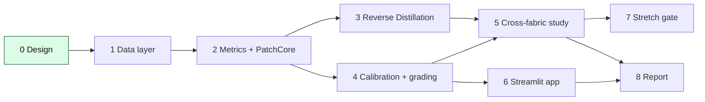

# LoomGuard: Implementation Plan

Related documents: [ARCHITECTURE.md](ARCHITECTURE.md), [DATASETS.md](DATASETS.md), [EVALUATION.md](EVALUATION.md), [PROGRESS_LOG.md](PROGRESS_LOG.md).

## How to use this plan

- Work through the phases in order. A phase is done only when every acceptance criterion is ticked and the evidence is recorded in `PROGRESS_LOG.md`.
- This plan is the roadmap. Each phase is built by its own headless developer session under [WORKFLOW.md](WORKFLOW.md). That session first writes a detailed spec in `docs/specs/`, which must keep every acceptance criterion listed here. Status values: `Not started`, `Code complete`, `Runs complete`, `Done`.
- "Laptop" means CPU-only work with no dataset: code, unit tests on synthetic data, documentation. "Training PC" means anything that needs a GPU or a dataset.
- Update the status table below when a phase changes state.

## Status

| Phase | Title | Where | Rough effort | Status |
|---|---|---|---|---|
| 0 | Design and dataset verification | Laptop | 1 session | **Done** |
| 1 | Repository skeleton and data layer | Both | 1 week | Code complete |
| 2 | Metrics and PatchCore | Both | 1.5 weeks | Code complete |
| 3 | Reverse Distillation | Both | 1.5 weeks | Not started |
| 4 | Calibration, inspection and grading | Both | 1 week | Not started |
| 5 | Cross-fabric study | Training PC | 2 weeks | Not started |
| 6 | Streamlit application | Laptop | 1.5 weeks | Not started |
| 7 | Stretch goals (decision gate) | Both | optional | Not started |
| 8 | Report and release | Laptop | 1 week | Not started |

Phases 3 and 4 can run in parallel once Phase 2 is done: one person on the training PC trains Reverse Distillation while the other writes the inspection layer on the laptop. Phase 6 can start as soon as Phase 4 has one working bundle.

---

## Phase 0: Design and dataset verification

**Objective.** Turn the starter idea into a checked design: verified datasets, fixed architecture, metrics, splits and a phased plan.

**Description.** Research and documentation only. No code, no downloads.

**Deliverables.** `docs/ARCHITECTURE.md`, `docs/DATASETS.md`, `docs/EVALUATION.md`, this plan, `docs/PROGRESS_LOG.md`, `README.md`.

**Acceptance criteria.**

- [x] Every dataset in the starter file has a verified status, size, licence and role, or an explicit "unverified" note.
- [x] Both model architectures are specified with tensor shapes, parameter counts, and which parts are frozen or trained.
- [x] Metrics, splits and pass criteria are written down before any code exists.
- [x] Team review complete, open questions in the README answered. (Answered on 2026-11-12 and recorded in `DECISIONS.md`. The third method stays an open decision, O-01.)

---

## Phase 1: Repository skeleton and data layer

**Objective.** Any dataset can be turned into a manifest of tiles with leak-free splits, and any image can be tiled and stitched back exactly.

**Description.** Create the package layout from ARCHITECTURE.md section 12. Write the tiler and stitcher, the manifest builders for MVTec AD textures and RAW-FABRID, and the dataset class that crops tiles at load time. On the training PC, download the four core datasets and write a verification script that compares what is on disk with DATASETS.md.

**Tasks.**

1. `pyproject.toml`, `.gitignore` (`data/`, `artifacts/`, checkpoints), package skeleton, `pytest` set up. (Laptop) **Done 2026-11-12**; `pytest` installed 2026-11-13.
2. `loomguard/data/tiling.py`: tile origins, tile, stitch with overlap averaging. (Laptop) **Done 2026-11-13**
3. `loomguard/data/manifest.py`: adapters for MVTec-style folders and RAW-FABRID; split assignment by parent image. (Laptop) **Done 2026-11-13**
4. `loomguard/data/dataset.py`: PyTorch `Dataset` that reads a manifest, crops, converts grayscale to three channels, normalises. (Laptop) **Done 2026-11-13**
5. Environment on the training PC: PyTorch 2.7 or newer with CUDA 12.8 wheels. (Training PC)
6. Download RAW-FABRID, ZJU-Leaper, MVTec AD, AITEX. `scripts/verify_datasets.py` prints counts, image sizes and mask pairing. (Training PC) Script written and tested on synthetic trees 2026-11-13; the download and the run are the operator's (runbook in `docs/specs/phase-1-data-layer.md`).
7. Look at the seven RAW-FABRID rolls and record whether they are visually different fabrics. (Training PC)

**Acceptance criteria.**

- [x] `stitch(tile(x)) == x` exactly for sizes 1792x1024, 512x512, 4096x256 and 800x640 (unit test).
- [x] Unit test proves no parent image appears in more than one split, for every manifest builder.
- [ ] RAW-FABRID manifest reproduces the official numbers: 14,196 train-pool tiles, 4,969 test-good, 687 test-defect, and every tile's label matches `RAW_FABRID_Patches_Metadata.csv`. (Builder, comparison function and synthetic tests done; the real-data run is runbook step 5.)
- [ ] `torch.cuda.get_arch_list()` on the training PC contains `sm_120`.
- [ ] `verify_datasets.py` output is pasted into `PROGRESS_LOG.md`. Every "unverified" item in DATASETS.md is resolved or corrected.
- [x] `pytest` passes on the laptop with no dataset present. (41 passed.)

---

## Phase 2: Metrics and PatchCore

**Objective.** A tested metrics module and a PatchCore implementation that reproduces published numbers on MVTec AD textures.

**Description.** Metrics come first so that every later number can be trusted. Then the shared backbone wrapper and PatchCore: feature extraction, coreset selection, memory bank, scoring. Validate on MVTec AD, then produce the first fabric numbers on RAW-FABRID.

**Tasks.**

1. `loomguard/eval/metrics.py`: AUROC, AP, pixel AUROC, pixel AP, AUPRO at 0.3, histogram-based versions for large test sets. (Laptop) **Done 2026-11-13**
2. `loomguard/models/backbone.py`: frozen WideResNet-50-2 returning layer1, layer2, layer3. (Laptop) **Done 2026-11-13**
3. `loomguard/models/patchcore.py`: pooling, concatenation, random projection, greedy k-center coreset, nearest-neighbour scoring, heatmap. (Laptop, with tiny tensors) **Done 2026-11-13**
4. `scripts/fit.py` and `scripts/evaluate.py` driven by a YAML config. (Laptop) **Done 2026-11-13**; tested end to end on synthetic trees.
5. Run PatchCore on the five MVTec textures, then on RAW-FABRID unified. (Training PC) Configs and runbook in `docs/specs/phase-2-metrics-patchcore.md`; the runs are the operator's.

**Acceptance criteria.**

- [x] AUPRO matches a brute-force implementation to 1e-6 on toy masks. A perfect heatmap scores 1.0 and a constant heatmap scores about 0. (Exactly 0 with the step integration of A-06; `tests/test_metrics.py`.)
- [x] Backbone unit test: for a 256x256 input the three outputs have shapes 256x64x64, 512x32x32, 1024x16x16, and no parameter requires gradients. (`tests/test_backbone.py`.)
- [ ] PatchCore on MVTec textures, mean over five categories: image AUROC 97.9 or more, pixel AUROC 96.6 or more, AUPRO 90.7 or more (EVALUATION.md section 3).
- [ ] Coreset selection for 600 tiles finishes in under 10 minutes on the training PC. Peak RAM and VRAM recorded.
- [ ] RAW-FABRID unified PatchCore results are in `results/` and summarised in `PROGRESS_LOG.md`.

---

## Phase 3: Reverse Distillation

**Objective.** A trained RD4AD model that reproduces published numbers on MVTec AD textures and gives the first trained-model results on fabric.

**Description.** Implement the bottleneck and the mirrored decoder, the cosine loss and the training loop with a fixed iteration budget. Train on MVTec textures first, then RAW-FABRID.

**Tasks.**

1. `loomguard/models/rd4ad.py`: bottleneck (fusion convolutions and embedding blocks), decoder with transposed convolutions, loss, anomaly map. (Laptop)
2. Training loop in `scripts/fit.py`: Adam, mixed precision, fixed iterations, loss logging, validation loss on normal tiles, last-checkpoint export in float16. (Laptop)
3. Train on the five MVTec textures. (Training PC)
4. Train on RAW-FABRID unified with 3 seeds. (Training PC)

**Acceptance criteria.**

- [ ] Shape unit test: embedding is 2048x8x8; decoder outputs are 256x64x64, 512x32x32, 1024x16x16.
- [ ] Trainable parameter count is 83.8 M (within 1 percent). The teacher has zero trainable parameters and stays in `eval()` mode during training (unit test).
- [ ] Overfit test: on 8 tiles the loss falls below 0.05 within 300 iterations.
- [ ] RD4AD on MVTec textures, mean over five categories: image AUROC 98.5 or more, pixel AUROC 96.7 or more, AUPRO 92.0 or more.
- [ ] Peak VRAM at batch 16 is under 11 GB. Measured iterations per second recorded, and the compute table in EVALUATION.md updated.
- [ ] No code path reads test data during training (code review item).
- [ ] RAW-FABRID unified results for 3 seeds are in `results/`, with mean and spread in `PROGRESS_LOG.md`.

---

## Phase 4: Calibration, inspection and grading

**Objective.** From an image and a bundle to a stitched heatmap, a mask, a defect table, points and a grade, through one `Inspector` class.

**Description.** Threshold calibration on normal validation tiles, mask cleanup, connected components, measurement in millimetres, four-point scoring, roll-level grading. This is CPU work and can be built on the laptop against a fake model that returns synthetic heatmaps.

**Tasks.**

1. `loomguard/eval/calibrate.py`: `tau` from validation maxima, score statistics, low-confidence flag. (Laptop)
2. `loomguard/inspection/postprocess.py`: threshold, closing, minimum area, connected components, length from the minimum-area rectangle. (Laptop)
3. `loomguard/inspection/grading.py`: points per defect, points per 100 square yards, grade; all cut-offs from config. (Laptop)
4. `loomguard/pipeline.py`: `Inspector` loading a bundle and running the full flow on an image or a list of frames. (Laptop)
5. Bundle export and load, including upload to the weights host. (Both)
6. Operating-point and grading metrics added to `scripts/evaluate.py`; run on RAW-FABRID per roll for both methods. (Training PC)

**Acceptance criteria.**

- [ ] Grading unit tests with synthetic masks: a 50 mm line scores 1 point, 100 mm scores 2, 200 mm scores 3, 300 mm scores 4, at 4 px/mm. An empty mask gives 0 points and grade A.
- [ ] Two blobs 3 px apart are merged into one defect; a 10 px blob is removed (unit tests).
- [ ] `Inspector` output on a full 1792x1024 image equals tiling, scoring and stitching done by hand (test with a deterministic fake model).
- [ ] On RAW-FABRID, false alarms on test-normal tiles are between 5 and 20 per 1,000 for the 10 per 1,000 target, for both methods. If not, the cause is analysed and written up.
- [ ] Per-roll grade from predicted masks and from ground-truth masks reported for all 7 rolls (points error and grade agreement).
- [ ] A bundle saved on the training PC loads and runs on the laptop CPU with `weights_only=True`.

---

## Phase 5: Cross-fabric study

**Objective.** Answer Q2, Q3, Q4 and Q7 from EVALUATION.md with complete result tables.

**Description.** Add the ZJU-Leaper and AITEX manifest adapters. Run both methods in every regime, the held-out tests and the ablations. Debug everything on ZJU-mini first.

**Tasks.**

1. ZJU-Leaper adapter reading the official JSON split files; AITEX adapter with border-tile filtering. (Laptop, checked on the training PC)
2. ZJU-mini: both methods, per-pattern regime, plus the resolution ablation. (Training PC)
3. Full ZJU-Leaper: per pattern (19), per group (5), unified (1), held-out (5), both methods. (Training PC)
4. RAW-FABRID: per roll (7), leave-one-roll-out (7), both methods. AITEX: per fabric (7), both methods. (Training PC)
5. Remaining ablations: coreset ratio, training-set size, overlap. (Training PC)
6. Summary script that turns `results/` into tables and plots. (Laptop)
7. ZJU-Leaper official metrics through the dataset's `ZLEval`. (Training PC)

**Acceptance criteria.**

- [ ] Every cell of the regime table in EVALUATION.md section 4.3 has a result file for both methods.
- [ ] Every run can be reproduced with one command and one config file; the config path and git commit are in each result JSON.
- [ ] All four ablations in section 4.4 are run and plotted.
- [ ] A written findings section answers Q2, Q3, Q4 and Q7 with numbers, including where each method fails, with at least three failure-case images per method.
- [ ] Headline settings were not changed after looking at test results; any deviation is logged with its reason.

---

## Phase 6: Streamlit application

**Objective.** A product-like demo: upload an image and get the heatmap, mask, defect list, points and grade. Also a roll stream and a results page.

**Description.** Thin UI over the `Inspector`. Runs on CPU. Bundles are downloaded from the weights host on first use.

**Tasks.**

1. Page "Inspect image": fabric profile and model selectors, upload or sample picker, overlay, mask, defect table, sensitivity slider. (Laptop)
2. Page "Roll stream": plays the frames of a demo roll in order, live defect log, running points and final grade. (Laptop)
3. Page "Results": tables and plots from `results/`. (Laptop)
4. Upload validation: file type, size and pixel limits, safe decoding. (Laptop)
5. Bundle download and caching; a handful of CC BY sample images with attribution in `assets/samples/`. (Laptop)
6. Deployment to Hugging Face Spaces, free CPU tier. (Laptop)

**Acceptance criteria.**

- [ ] From a clean clone, `pip install` and `streamlit run app/streamlit_app.py` work on a CPU-only machine with no dataset.
- [ ] A 1792x1024 image is processed in under 10 seconds on the laptop CPU with the PatchCore 1 percent bundle. Measured time recorded.
- [ ] The app's heatmap and defect list for a sample image equal the output of `scripts/evaluate.py` for the same image and bundle.
- [ ] A non-image file, an oversized file and a corrupt image each produce a clear error message and no crash.
- [ ] An image of the wrong fabric produces the "unknown fabric" warning instead of a meaningless defect list.
- [ ] Results for uploaded images of unknown origin are labelled "assumed scale"; single-image grades are labelled as extrapolations.
- [ ] The roll stream runs to the end on a RAW-FABRID demo roll and its final grade matches the Phase 4 number.

---

## Phase 7: Stretch goals (decision gate)

**Objective.** Decide, with Phase 5 results in hand, which optional extension is worth the time. Do at most one or two.

Open decisions O-01 and O-02 in `DECISIONS.md` are settled here.

| Option | Do it if | Cost |
|---|---|---|
| Dinomaly (ViT-Small) as a third method | Reverse Distillation clearly degrades in the unified regime, so a model built for that regime is informative | High: transformer decoder, new backbone |
| TSFabrics stream with the cutline-as-normal test | The demo needs a more realistic stream than RAW-FABRID rolls | Medium: 9.2 GB, new adapter |
| Defect-type classification from a few labelled examples | The grading needs the hole rule of the four-point system | Medium: needs type labels, AITEX has 12 defect codes |
| Automatic fabric-profile selection in the app | Users find the manual selector confusing | Low: nearest mean feature per profile |

**Acceptance criteria.** Defined when an option is chosen. The decision and its reason are recorded in `PROGRESS_LOG.md`.

---

## Phase 8: Report and release

**Objective.** A written report and a repository a stranger can run.

**Tasks.**

1. Report: problem, methods, datasets, protocol, results, failure analysis, limits.
2. README with setup, how to reproduce each table, how to run the demo, dataset licences and citations.
3. Final clean run of the test suite and of one end-to-end reproduction on the training PC.

**Acceptance criteria.**

- [ ] Every number in the report traces to a file in `results/`.
- [ ] A teammate who did not write the code reproduces one MVTec row and one RAW-FABRID row from the README alone.
- [ ] Limits are stated: assumed scales, no hole rule, unknown-fabric behaviour, low-confidence calibrations, licences (MVTec non-commercial; ZJU-Leaper and AITEX without a stated licence).
- [ ] Datasets are cited as their authors request.

---

## Risks

| Risk | Likelihood | Effect | Response |
|---|---|---|---|
| ZJU-Leaper Google Drive quota blocks the download | Medium | Phase 5 delayed | Retry off-peak with `gdown`; try the authors' second host; RAW-FABRID alone still supports Q2 and Q4 |
| Our numbers miss the MVTec targets | Medium | Cannot trust later results | Upgrade the documented simplifications one at a time (1,024-d pooling, re-weighted score, centre crop) |
| RD4AD exceeds 12 GB VRAM | Low | Training blocked | Mixed precision is already on; lower the batch size to 8 |
| RAW-FABRID rolls turn out to be the same fabric | Medium | Leave-one-roll-out is not an unseen-fabric test | Use ZJU-Leaper held-out patterns for Q4 only |
| PatchCore too slow on the laptop CPU | Medium | Demo feels sluggish | 1 percent coreset; then FAISS; then a smaller bank |
| Too few validation tiles make `tau` unstable (AITEX, roll 3) | High | False-alarm rate off target | Already flagged as low-confidence; report it as a finding |
| Scope creep from stretch goals | Medium | Core study unfinished | Phase 7 is gated behind Phase 5 |
