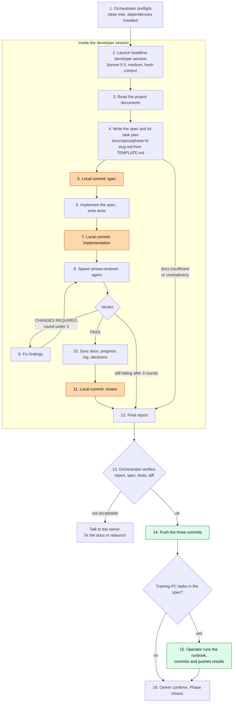

# LoomGuard: Workflow

How the project is built, phase by phase. This file is the process; [IMPLEMENTATION_PLAN.md](IMPLEMENTATION_PLAN.md) is the roadmap; [DECISIONS.md](DECISIONS.md) is the record of what was agreed.

## 1. The idea

1. **A fresh session per phase.** Each phase is done from start to finish by a new headless Claude session with an empty context. It learns everything from the repository, not from an earlier chat.
2. **Spec first, inside that session.** The session's first job is to write the phase spec from the project documents. It then plans, implements and gets reviewed against that spec.
3. **Independent review.** Before the session finishes, a reviewer agent with its own fresh context checks the spec, the work, the tests and the documentation. The developer fixes what it finds, and the loop repeats until the review passes.
4. **One orchestrator.** The main interactive session keeps the high-level view: it launches each session with a good prompt, verifies its report and pushes to GitHub. It does not write specs or phase code.
5. **Documents are the memory.** Anything that matters is written to a file in `docs/`. Nothing important lives only in a chat.

## 2. Roles

| Role | Who | Model | Does | Does not |
|---|---|---|---|---|
| Project owner | Zain | | Makes decisions, reads the phase report and spec, confirms phase closure | |
| Orchestrator | Main interactive Claude session | Fable 5.2 | Prepares the environment, launches the developer session with the prompt, verifies its report, pushes, keeps DECISIONS.md current | Write specs or phase code |
| Developer session | Headless Claude session, new for every phase | Sonnet 5.5, medium effort | Writes the spec, plans, implements, writes tests, runs the review loop, updates docs, commits locally | Push, change the architecture, decide open questions, download data, train models |
| Reviewer agent | `phase-reviewer` subagent spawned by the developer session | Sonnet 5.5, medium effort | Reviews and tests the phase against the plan, its spec and the docs; returns a verdict | Edit files |
| Training-PC operator | Teammate with the RTX 5070 | | Runs the spec's training-PC runbook, records results | |

## 3. Phase lifecycle



A phase passes through these states, shown in the status table of `IMPLEMENTATION_PLAN.md`:

`Not started` → `Code complete` → `Runs complete` (only if the phase has training-PC tasks) → `Done`

## 4. Steps in detail

### Step 1: preflight (orchestrator)

Before launching, the orchestrator checks:

- `git status` is clean and `main` is up to date with `origin/main`.
- The previous phase is `Done`, or `Code complete` with its training-PC runbook queued (decision D-58), or the owner has agreed to start anyway. Under D-58 a phase never waits for training-PC results; only decisions that need measured results (O-01 at the Phase 7 gate) wait for them.
- The packages the phase will need are installed. The developer session is not allowed to install packages. The orchestrator lists what is installed in the prompt's notes.
- The existing tests pass.
- The project virtual environment `.venv/` is activated in the shell that launches the session (`source .venv/bin/activate`), so that `python3` and `pytest` inside the session resolve to it and not to the system Python, which has no PyTorch.

### Step 2: launch (orchestrator)

Run from the repository root, with the prompt from section 5 filled in:

```bash
claude -p "$(cat <<'EOF'
<the developer prompt from section 5, with N, TITLE and NOTES filled in>
EOF
)" \
  --model claude-sonnet-5-5 --effort medium \
  --name "loomguard-phase-N" \
  --permission-mode acceptEdits \
  --allowedTools "Read" "Edit" "Write" "Glob" "Grep" "Agent" \
    "Bash(python3:*)" "Bash(python:*)" "Bash(pytest:*)" \
    "Bash(git status:*)" "Bash(git diff:*)" "Bash(git log:*)" \
    "Bash(git add:*)" "Bash(git commit:*)"
```

What these permissions mean: the session can edit files, run Python and the tests, spawn the reviewer, and commit locally. It cannot push, install packages or run other shell commands; in headless mode anything outside the list is refused.

### Steps 3 to 5: the spec (developer session)

- The session reads the project documents, then copies `docs/specs/TEMPLATE.md` to `docs/specs/phase-<N>-<slug>.md` and fills in every section.
- Sources for the spec: the phase's entry in `IMPLEMENTATION_PLAN.md` (objective, tasks, acceptance criteria), `ARCHITECTURE.md`, `EVALUATION.md`, `DATASETS.md`, `DECISIONS.md` and the existing code.
- The spec must contain every acceptance criterion the plan lists for the phase, unchanged in meaning. It may make them more precise and may add criteria. It may not drop or weaken one.
- Each acceptance criterion names how it is verified: a test, a command, or a training-PC measurement.
- The task plan is section 5 of the spec: ordered tasks, separated into **laptop** (the session does them) and **training PC** (the runbook).
- Nothing in the spec may depend on an open decision in `DECISIONS.md`.
- If the documents are not enough to write the spec, or contradict each other on something that matters, the session writes down the question and stops with `BLOCKED` before coding.
- Local commit: `phase N: spec`.

Nobody approves the spec before coding starts. Its safeguards are the owner-approved plan it must cover, the reviewer's check of the spec against that plan, and the owner reading it with the final report.

### Steps 6 to 12: implementation and review (developer session)

Defined by the developer prompt in section 5 and the reviewer in section 6.

### Steps 13 and 14: verification (orchestrator)

The orchestrator does not trust the report alone. It:

1. reads the final report,
2. reads the spec and checks it against the phase's entry in the plan,
3. runs the test suite itself,
4. reads `git log` and the diff summary, and checks that only files the spec names were changed,
5. checks the new entries in `PROGRESS_LOG.md` and `DECISIONS.md`,
6. pushes if all of that holds, and reports to the owner.

If the report says `BLOCKED` or `REVIEW NOT PASSED`, nothing is pushed until the owner has decided what to do.

### Step 15: training-PC runs (operator)

The operator pulls `main`, runs the commands in the spec's runbook, and records the output: result files in `results/`, an entry in `PROGRESS_LOG.md`, and the ticked criteria in the spec. Commit message: `phase N: results`. The operator may use their own headless session for this, with the runbook as its task.

If a measurement contradicts a number in the docs, the document is corrected in the same commit.

### Step 16: closing

The owner confirms. The orchestrator sets the phase to `Done` in `IMPLEMENTATION_PLAN.md`, moves confirmed rows in `DECISIONS.md` from "Awaiting confirmation" to "Accepted", and starts the next phase at step 1 with a new session.

## 5. Developer prompt

The orchestrator fills in `{N}`, `{TITLE}` and `{NOTES}` and passes this as the prompt. It is the complete instruction set for the developer session.

```text
You are the developer for phase {N} ("{TITLE}") of LoomGuard, a PyTorch fabric
anomaly-detection project. You start with no memory of earlier work. Everything you
need is in this repository. You run headless: nobody can answer questions while you
work. You do the whole phase in this session: spec, plan, implementation, review.

READ FIRST, in this order, before writing anything:
1. CLAUDE.md                      project rules that must not be broken
2. docs/WORKFLOW.md               the process you are part of
3. docs/IMPLEMENTATION_PLAN.md    the entry for phase {N} is your assignment; skim the rest
4. docs/DECISIONS.md              what is agreed, what is open
5. docs/ARCHITECTURE.md           the design you must follow
6. docs/EVALUATION.md             metrics, splits and pass criteria
7. docs/DATASETS.md               if your phase touches data
8. docs/PROGRESS_LOG.md           the latest two entries
9. docs/specs/                    TEMPLATE.md and the specs of earlier phases
10. the existing code under loomguard/, scripts/, app/ and tests/

NOTES FROM THE ORCHESTRATOR
{NOTES}

PART 1: WRITE THE SPEC
- Copy docs/specs/TEMPLATE.md to docs/specs/phase-{N}-<slug>.md and fill in every
  section. Write "None" where a section does not apply.
- Build it from the phase {N} entry in the plan and from the design documents. Do not
  invent requirements and do not redesign.
- Include every acceptance criterion the plan lists for phase {N}, unchanged in
  meaning. You may make them more precise and add criteria. You may not drop or weaken
  one. Each criterion names the test or command that verifies it.
- Section 4 must give exact file paths, public function and class signatures, tensor
  shapes and dtypes, taken from ARCHITECTURE.md.
- Section 5 is your plan: ordered tasks, split into "laptop" (yours) and
  "training PC" (not yours; they go into the runbook in section 8).
- Nothing in the spec may depend on an item under "Open" in docs/DECISIONS.md.
- If the documents are not enough to write a section that matters, or contradict each
  other, write the question into section 10, commit, and stop: report BLOCKED.
- Commit locally:  phase {N}: spec

PART 2: IMPLEMENT
Implement the laptop tasks of your spec so that every laptop acceptance criterion
passes. Do not download datasets, do not train models, do not need a GPU. Write the
code and the runbook commands so the training-PC operator can run them later.

STANDARDS
- The docs are the design. Match names, shapes and file locations from
  ARCHITECTURE.md exactly.
- Smallest code that meets the acceptance criteria. No features, abstractions or files
  the spec does not ask for.
- Every piece of non-trivial logic gets a CPU test under tests/ that needs no dataset.
  Use small synthetic tensors and images.
- Run the full test suite before you call anything done. Report real output.
- If you find while coding that the spec is wrong, fix the spec and say so in its
  completion record under "Deviations". Never weaken a criterion that came from the
  plan.
- Do not install packages. If you need one that is not installed, report BLOCKED and
  name it.
- Never push. Never commit data, model files or anything under data/ or artifacts/.
- Commit locally when the tests pass:  phase {N}: implementation

DECISIONS
- A choice inside the spec's freedom (a helper name, an internal data structure): just
  make it.
- A choice the documents leave open but that is easy to reverse: make it, and add a row
  to "Awaiting confirmation" in docs/DECISIONS.md with your reason.
- A choice that changes the architecture, a metric, a split, an interface used by
  another phase, or anything listed under "Open" in docs/DECISIONS.md: do not make it.
  Finish what does not depend on it, then report BLOCKED with the question.

PART 3: REVIEW LOOP
1. Spawn the reviewer: Agent tool, subagent_type "phase-reviewer", with the prompt
   "Review phase {N}. Spec: <path of your spec>. Round R." Give it nothing else; it
   must form its own view.
2. If the verdict is CHANGES REQUIRED, fix every blocking finding, rerun the tests and
   spawn a new reviewer. At most 3 rounds. If a finding is wrong, say why in your
   report instead of silently ignoring it.
3. When the verdict is PASS, bring the documents in line with what you built:
   - your spec: tick the criteria you met, fill in the completion record, set the status
   - docs/IMPLEMENTATION_PLAN.md: tick the matching criteria, set the phase status to
     "Code complete" (or "Done" if the spec has no training-PC tasks)
   - docs/PROGRESS_LOG.md: add an entry at the top using the template in that file,
     including the test output summary, review rounds and verdict
   - docs/DECISIONS.md: rows for any decisions you made
   - docs/ARCHITECTURE.md, docs/EVALUATION.md, docs/DATASETS.md, README.md, CLAUDE.md:
     correct anything your work made inaccurate. Do not rewrite what is still true.
4. Commit locally:  phase {N}: review fixes and doc sync
5. Print the final report.

FINAL REPORT, exactly this structure, as your last message:
STATUS: COMPLETE | BLOCKED | REVIEW NOT PASSED
PHASE: {N}
SPEC: <path>
COMMITS: <hashes and messages>
TESTS: <command, passed/failed counts>
ACCEPTANCE CRITERIA: <each laptop criterion: met / not met, with the evidence>
TRAINING-PC TASKS LEFT: <list, or none>
REVIEW: <rounds, final verdict, findings you did not fix and why>
DECISIONS MADE: <ids added to DECISIONS.md, or none>
QUESTIONS FOR THE OWNER: <or none>
FILES CHANGED: <list>
```

## 6. Reviewer agent

Defined in `.claude/agents/phase-reviewer.md`, so every session on every machine gets the same reviewer. It has read-only tools plus the ability to run tests. It checks:

1. **The spec.** It covers every acceptance criterion the plan lists for the phase without weakening any, follows the template, and agrees with the design documents. This check matters because the developer wrote the spec itself.
2. **Acceptance criteria.** Each laptop criterion of the spec, verified by running the test or command itself. A criterion without evidence is not met.
3. **Tests.** The whole suite passes. The tests would fail if the logic were wrong (no tests that only check that code runs).
4. **Architecture drift.** Names, tensor shapes, file locations, interfaces and settings match `ARCHITECTURE.md` and the spec.
5. **Rules.** The rules in `CLAUDE.md`, above all: split before tiling, no test-set influence, frozen backbone, single `Inspector` path.
6. **Decisions.** Nothing contradicts an accepted decision. Nothing depends on an open one. New decisions are recorded.
7. **Stale documentation.** Every document describes the code as it now is. Status tables, checkboxes and the progress log are current.
8. **Scope.** No files or features beyond the spec. No data or model files staged.

It returns `PASS` or `CHANGES REQUIRED` with numbered findings, each marked blocking or minor and tied to a file and line.

## 7. Where things are written

| What | Where | Written by |
|---|---|---|
| What a phase must build, and its task plan | `docs/specs/phase-<N>-<slug>.md` | Developer session |
| Phase status and roadmap criteria | `docs/IMPLEMENTATION_PLAN.md` | Developer session; orchestrator at closing |
| What was done, measured, reviewed | `docs/PROGRESS_LOG.md`, newest entry first | Developer session, operator |
| Decisions: accepted, awaiting confirmation, open, dropped | `docs/DECISIONS.md` | Developer session adds "awaiting confirmation"; orchestrator records the owner's decisions |
| Design facts that changed | `docs/ARCHITECTURE.md`, `docs/EVALUATION.md`, `docs/DATASETS.md` | Whoever found the change |
| Metrics from runs | `results/<dataset>/<regime>/<method>/<fabric>.json` | Operator |
| Rules for any Claude session in this repo | `CLAUDE.md` | Orchestrator |

## 8. Commits

Three local commits per phase, all made by the developer session, plus one from the training PC.

| When | Message | Made by | Pushed by |
|---|---|---|---|
| Spec written | `phase N: spec` | Developer session | Orchestrator, after verification |
| Code written, tests pass | `phase N: implementation` | Developer session | Orchestrator, after verification |
| Review passed, docs in sync | `phase N: review fixes and doc sync` | Developer session | Orchestrator, after verification |
| Training-PC runs recorded | `phase N: results` | Operator | Operator |

The developer session never pushes. Its commits reach GitHub only after the orchestrator has verified them.

## 9. When a session must stop

| Situation | What the developer session does |
|---|---|
| The documents are not enough to write the spec, or contradict each other | Write the question into the spec, commit, report `BLOCKED` before coding |
| A decision outside its authority is needed | Finish what is unaffected, report `BLOCKED` with the exact question |
| A package is missing | Report `BLOCKED`, name the package |
| Three review rounds without `PASS` | Commit what exists, report `REVIEW NOT PASSED` with the open findings |
| A task needs a GPU or a dataset | Leave it for the runbook, list it under "training-PC tasks left" |
