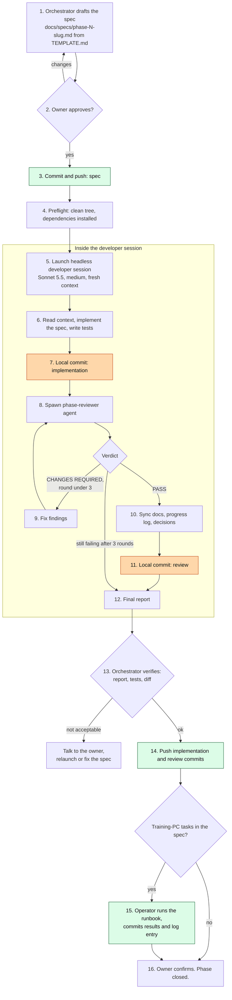

# LoomGuard: Workflow

How the project is built, phase by phase. This file is the process; [IMPLEMENTATION_PLAN.md](IMPLEMENTATION_PLAN.md) is the roadmap; [DECISIONS.md](DECISIONS.md) is the record of what was agreed.

## 1. The idea

1. **Spec first.** Every phase gets a written spec before any code.
2. **A fresh session per phase.** Each phase is implemented by a new headless Claude session with an empty context. It learns everything from the repository, not from an earlier chat.
3. **Independent review.** Before the session finishes, a reviewer agent with its own fresh context checks the work, the tests and the documentation. The developer fixes what it finds, and the loop repeats until the review passes.
4. **One orchestrator.** The main interactive session keeps the high-level view: it writes specs, launches sessions, verifies their reports and pushes to GitHub.
5. **Documents are the memory.** Anything that matters is written to a file in `docs/`. Nothing important lives only in a chat.

## 2. Roles

| Role | Who | Model | Does | Does not |
|---|---|---|---|---|
| Project owner | Zain | | Approves specs, makes decisions, confirms phase closure | |
| Orchestrator | Main interactive Claude session | Fable 5.2 | Writes the spec with the owner, prepares the environment, launches the developer session, verifies its report, pushes, updates DECISIONS.md | Write phase code itself |
| Developer session | Headless Claude session, new for every phase | Sonnet 5.5, medium effort | Implements the spec, writes tests, updates docs, runs the review loop, commits locally | Push, change the architecture, decide open questions, download data, train models |
| Reviewer agent | `phase-reviewer` subagent spawned by the developer session | Sonnet 5.5, medium effort | Reviews and tests the phase against its spec and the docs, returns a verdict | Edit files |
| Training-PC operator | Teammate with the RTX 5070 | | Runs the spec's training-PC runbook, records results | |

## 3. Phase lifecycle



A phase passes through these states, shown in the status table of `IMPLEMENTATION_PLAN.md`:

`Not started` → `Spec approved` → `Code complete` → `Runs complete` (only if the phase has training-PC tasks) → `Done`

## 4. Steps in detail

### Steps 1 to 3: the spec

- The orchestrator copies `docs/specs/TEMPLATE.md` to `docs/specs/phase-<N>-<slug>.md` and fills it in with the owner.
- The spec must cover every acceptance criterion that `IMPLEMENTATION_PLAN.md` lists for the phase. It may refine or add criteria. If it changes one, the plan is edited in the same commit.
- Each acceptance criterion names how it is verified: a test, a command, or a training-PC measurement.
- Tasks are separated into **laptop** (the developer session does them) and **training PC** (the runbook).
- Nothing in the spec may depend on an open decision in `DECISIONS.md`.
- The owner approves. Commit message: `phase N: spec`. Push.

### Step 4: preflight

Before launching, the orchestrator checks:

- `git status` is clean and `main` is up to date with `origin/main`.
- Every dependency the spec lists is installed in the environment. The developer session is not allowed to install packages.
- The existing tests pass.

### Step 5: launch

Run from the repository root, with `N`, the slug and the spec path filled in:

```bash
claude -p "$(cat <<'EOF'
<the developer prompt from section 5, with N and the spec path filled in>
EOF
)" \
  --model claude-sonnet-5-5 --effort medium \
  --name "loomguard-phase-N" \
  --permission-mode acceptEdits \
  --allowedTools "Read" "Edit" "Write" "Glob" "Grep" "Agent" \
    "Bash(python3:*)" "Bash(python:*)" "Bash(pytest:*)" \
    "Bash(git status:*)" "Bash(git diff:*)" "Bash(git log:*)" \
    "Bash(git add:*)" "Bash(git commit:*)"
```

What these permissions mean: the session can edit files, run Python and the tests, spawn the reviewer, and commit locally. It cannot push, install packages or run other shell commands; in headless mode anything outside the list is refused.

### Steps 6 to 12: inside the developer session

Defined by the developer prompt in section 5 and the reviewer in section 6.

### Steps 13 and 14: verification by the orchestrator

The orchestrator does not trust the report alone. It:

1. reads the final report,
2. runs the test suite itself,
3. reads `git log` and the diff summary, and checks that only files allowed by the spec changed,
4. checks the new entries in `PROGRESS_LOG.md` and `DECISIONS.md`,
5. pushes if all of that holds, and reports to the owner.

If the report says `BLOCKED` or `REVIEW NOT PASSED`, nothing is pushed until the owner has decided what to do.

### Step 15: training-PC runs

The operator pulls `main`, runs the commands in the spec's runbook, and records the output: result files in `results/`, an entry in `PROGRESS_LOG.md`, and the ticked criteria in the spec. Commit message: `phase N: results`. The operator may use their own headless session for this, with the runbook as its task.

If a measurement contradicts a number in the docs, the document is corrected in the same commit.

### Step 16: closing

The owner confirms. The orchestrator sets the phase to `Done` in `IMPLEMENTATION_PLAN.md`, moves confirmed rows in `DECISIONS.md` from "Awaiting confirmation" to "Accepted", and starts the next phase at step 1 with a new session.

## 5. Developer prompt

The orchestrator fills in `{N}` and `{SPEC}` and passes this as the prompt. It is the complete instruction set for the developer session.

```text
You are the developer for phase {N} of LoomGuard, a PyTorch fabric anomaly-detection
project. You start with no memory of earlier work. Everything you need is in this
repository. You run headless: nobody can answer questions while you work.

READ FIRST, in this order, before writing anything:
1. CLAUDE.md                    project rules that must not be broken
2. docs/WORKFLOW.md             the process you are part of
3. {SPEC}                       your task; it is your contract
4. docs/DECISIONS.md            what is agreed, what is open
5. docs/ARCHITECTURE.md         only the sections your spec refers to
6. docs/EVALUATION.md           only the sections your spec refers to
7. docs/PROGRESS_LOG.md         the latest two entries
8. the existing code under loomguard/ and tests/ that your spec touches

YOUR JOB
Implement the laptop tasks of the spec so that every laptop acceptance criterion
passes. Tasks marked "training PC" are not yours: do not download datasets, do not
train models, do not need a GPU. Write the code and the commands so the training-PC
operator can run them later.

STANDARDS
- The spec and docs/ are the design. Do not redesign. Match names, shapes and file
  locations from ARCHITECTURE.md exactly.
- Smallest code that meets the acceptance criteria. No features, abstractions or files
  the spec does not ask for.
- Every piece of non-trivial logic gets a CPU test under tests/ that needs no dataset.
  Use small synthetic tensors and images.
- Run the full test suite before you call anything done. Report real output.
- Do not install packages. If you need a dependency the spec does not list, stop and
  report BLOCKED.
- Never push. Never commit data, model files or anything under data/ or artifacts/.

DECISIONS
- A choice inside the spec's freedom (a helper name, an internal data structure): just
  make it.
- A choice the spec leaves open but that is easy to reverse: make it, and add a row to
  "Awaiting confirmation" in docs/DECISIONS.md with your reason.
- A choice that changes the architecture, a metric, a split, an interface used by
  another phase, or anything listed under "Open" in docs/DECISIONS.md: do not make it.
  Finish what does not depend on it, then report BLOCKED with the question.

STEPS
1. Implement the spec. Run the tests until they pass.
2. Commit locally:  phase {N}: implementation
3. Spawn the reviewer: Agent tool, subagent_type "phase-reviewer", with the prompt
   "Review phase {N}. Spec: {SPEC}. Round R." Give it nothing else; it must form its
   own view.
4. If the verdict is CHANGES REQUIRED, fix every blocking finding, rerun the tests and
   spawn a new reviewer. At most 3 rounds. If a finding is wrong, say why in your
   report instead of silently ignoring it.
5. When the verdict is PASS, bring the documents in line with what you built:
   - {SPEC}: tick the criteria you met, fill in the completion record
   - docs/IMPLEMENTATION_PLAN.md: tick the matching criteria, set the phase status to
     "Code complete" (or "Done" if the spec has no training-PC tasks)
   - docs/PROGRESS_LOG.md: add an entry at the top using the template in that file,
     including the test output summary, review rounds and verdict
   - docs/DECISIONS.md: rows for any decisions you made
   - docs/ARCHITECTURE.md, docs/EVALUATION.md, docs/DATASETS.md, README.md, CLAUDE.md:
     correct anything your work made inaccurate. Do not rewrite what is still true.
6. Commit locally:  phase {N}: review fixes and doc sync
7. Print the final report.

FINAL REPORT, exactly this structure, as your last message:
STATUS: COMPLETE | BLOCKED | REVIEW NOT PASSED
PHASE: {N}
COMMITS: <hashes and messages>
TESTS: <command, passed/failed counts>
ACCEPTANCE CRITERIA: <each laptop criterion: met / not met, with the evidence>
TRAINING-PC TASKS LEFT: <list, or none>
REVIEW: <rounds, final verdict, findings you did not fix and why>
DECISIONS MADE: <ids added to DECISIONS.md, or none>
QUESTIONS FOR THE OWNER: <or none>
FILES CHANGED: <list>
```

## 6. Reviewer agent

Defined in `.claude/agents/phase-reviewer.md`, so every session on every machine gets the same reviewer. It has read-only tools plus the ability to run tests. It checks:

1. **Acceptance criteria.** Each laptop criterion of the spec, verified by running the test or command itself. A criterion without evidence is not met.
2. **Tests.** The whole suite passes. The tests would fail if the logic were wrong (no tests that only check that code runs).
3. **Architecture drift.** Names, tensor shapes, file locations, interfaces and settings match `ARCHITECTURE.md` and the spec.
4. **Rules.** The rules in `CLAUDE.md`, above all: split before tiling, no test-set influence, frozen backbone, single `Inspector` path.
5. **Decisions.** Nothing contradicts an accepted decision. Nothing depends on an open one. New decisions are recorded.
6. **Stale documentation.** Every document describes the code as it now is. Status tables, checkboxes and the progress log are current.
7. **Scope.** No files or features beyond the spec. No data or model files staged.

It returns `PASS` or `CHANGES REQUIRED` with numbered findings, each marked blocking or minor and tied to a file and line.

## 7. Where things are written

| What | Where |
|---|---|
| What a phase must build | `docs/specs/phase-<N>-<slug>.md` |
| Phase status and roadmap criteria | `docs/IMPLEMENTATION_PLAN.md` |
| What was done, measured, reviewed | `docs/PROGRESS_LOG.md`, newest entry first |
| Decisions: accepted, awaiting confirmation, open, dropped | `docs/DECISIONS.md` |
| Design facts that changed | `docs/ARCHITECTURE.md`, `docs/EVALUATION.md`, `docs/DATASETS.md` |
| Metrics from runs | `results/<dataset>/<regime>/<method>/<fabric>.json` |
| Rules for any Claude session in this repo | `CLAUDE.md` |

## 8. Commits

| When | Message | Made by | Pushed by |
|---|---|---|---|
| Spec approved | `phase N: spec` | Orchestrator | Orchestrator, immediately |
| Code written, tests pass | `phase N: implementation` | Developer session | Orchestrator, after verification |
| Review passed, docs in sync | `phase N: review fixes and doc sync` | Developer session | Orchestrator, after verification |
| Training-PC runs recorded | `phase N: results` | Operator | Operator |

The developer session never pushes. The two commits it makes reach GitHub only after the orchestrator has verified them.

## 9. When a session must stop

| Situation | What the developer session does |
|---|---|
| The spec is ambiguous or contradicts the docs | Finish what is unaffected, report `BLOCKED` with the exact question |
| A decision outside its authority is needed | Same |
| A dependency is missing | Report `BLOCKED`, name the package |
| Three review rounds without `PASS` | Commit what exists, report `REVIEW NOT PASSED` with the open findings |
| A task needs a GPU or a dataset | Leave it for the runbook, list it under "training-PC tasks left" |
